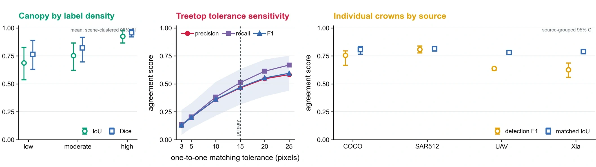

<div align="center">


**English** | [中文](README.zh-CN.md)

**A global, human-verified benchmark connecting canopy-region masks, treetop points, and individual-crown polygons across satellite —built for scalable forest mapping and AI research.**

[](#-release-status)
[](#-release-status)
[](#-annotation-production)
[](#-global-coverage)
[](examples/real_sample_package_v1/)
[](#-citation)

[Overview](#-overview) · [Demos](#-annotation-demos) · [Real samples](#-real-sample-package) · [Dataset](#-dataset-components) · [Coverage](#-global-coverage) · [Annotations](#-annotation-production) · [Quality control](#-quality-control) · [Contributors](#-contributors-and-institutions) · [Access](#-data-access) · [Citation](#-citation)

</div>

## 🌍 Overview

Global Forest Crown Annotations brings together three annotation products that describe forest structure at different spatial levels:

1. **Canopy-region masks** capture continuous areas occupied by tree canopy.
2. **Treetop points** identify individual treetop locations at scene scale.
3. **Individual-crown polygons** delineate the visible boundary of each tree crown.

These products are complementary rather than interchangeable. Together, they provide a bridge from landscape-scale canopy extent to tree locations and crown-level geometry, supporting dataset benchmarking, model development and ecological analysis across varied geographic contexts.

### Three views of one forest scene

<table>
  <tr>
    <td width="33.33%" align="center">
      
      <br><b>01 · Canopy region</b>
      <br><sub>Continuous canopy extent</sub>
    </td>
    <td width="33.33%" align="center">
      
      <br><b>02 · Treetop points</b>
      <br><sub>Individual tree locations</sub>
    </td>
    <td width="33.33%" align="center">
      
      <br><b>03 · Crown polygons</b>
      <br><sub>Instance-level boundaries</sub>
    </td>
  </tr>
</table>

### At a glance

| Component | Released unit | Verified scale | Annotation route | Primary colour |
|:--|:--|--:|:--|:--:|
| **Canopy-region masks** | Raster mosaic | **27 mosaics** | **100% manual** | 🟢 |
| **Treetop points** | Scene-level point layer | **1,306,763 effective markers in 26 SVG scenes** | **100% manual** | 🔴 |
| **Individual-crown polygons** | Crown instance | **459,756 crowns in 6,802 RGB images** | ≈70% direct manual; ≈30% model candidates, all corrected and confirmed by humans | 🟠 |

## 🎥 Annotation demos

<table>
  <tr>
    <td width="50%" align="center">
      <a href="assets/readme/treetop-annotation-demo.mp4">
        
      </a>
      <br><b>Treetop-point annotation</b>
      <br><sub>Click the animation to open the MP4 video.</sub>
    </td>
    <td width="50%" align="center">
      <a href="assets/readme/crown-annotation-demo.mp4">
        
      </a>
      <br><b>Individual-crown annotation</b>
      <br><sub>Click the animation to open the MP4 video.</sub>
    </td>
  </tr>
</table>

Both previews autoplay and loop on GitHub. The linked MP4 files preserve smoother motion and higher visual quality.

## 🚀 Real sample package

The repository includes a compact, integrity-checked package of **12 real examples** for immediate format inspection and loader development:

| Canopy-region masks | Treetop points | Individual-crown polygons |
|:--:|:--:|:--:|
| 4 scenes | 4 scenes | 4 images |
| Binary PNG/TIFF masks | CSV/JSON coordinates | RGB, contours, instance TIFF and area CSV |

<div align="center">

### [Explore the real sample package →](examples/real_sample_package_v1/)

<sub>Includes bilingual documentation, a file manifest and SHA-256 checksums.</sub>

</div>

## 🧩 Dataset components

### 1. Canopy-region masks

Canopy-region masks represent the spatial extent of visible tree canopy as raster labels. They are designed for tasks such as canopy-cover mapping, semantic segmentation and landscape-scale forest monitoring.

| Field | Description |
|:--|:--|
| **Representation** | Raster mask aligned with source imagery |
| **Annotation unit** | Continuous canopy region |
| **Production** | Fully manual delineation |
| **Current verified scale** | 27 mosaics |
| **Typical task** | Semantic segmentation / canopy-extent estimation |

### 2. Treetop points

Treetop points record the interpreted location of individual tree tops. Because a point occupies a very small spatial footprint, validation uses a practical spatial tolerance rather than an unrealistically strict pixel-perfect equality rule.

| Field | Description |
|:--|:--|
| **Representation** | Point annotations stored in scene-level vector layers |
| **Annotation unit** | One interpreted treetop location |
| **Production** | Fully manual placement |
| **Current verified scale** | 1,306,763 effective markers across 26 SVG scenes |
| **Typical task** | Point detection / tree counting / density estimation |

### 3. Individual-crown polygons

Individual-crown polygons describe visible crown boundaries at instance level. Approximately 70% were delineated directly by annotators; approximately 30% began as model-generated candidates. Every retained candidate was manually corrected and human confirmed before inclusion.

| Field | Description |
|:--|:--|
| **Representation** | Instance masks, contours and crown-area records |
| **Annotation unit** | One visible tree crown |
| **Production** | ≈70% direct manual + ≈30% model-candidate-assisted, followed by manual correction |
| **Current verified scale** | 459,756 crowns across 6,802 RGB images |
| **Typical task** | Instance segmentation / crown delineation / crown-size analysis |

## 🗺️ Global coverage

<div align="center">


*Mapped satellite-scene locations and representative released annotations. Country boundaries provide geographic reference in a Robinson projection.*

</div>

The collection was assembled to capture diverse forest appearances, crown structures and geographic settings. The map reports the available mapped scenes; representative examples around the map illustrate the annotation products and are not intended to imply equal sampling density among countries or biomes.

## 🖼️ Representative scene atlas

<div align="center">


</div>

The scene atlas highlights variability in canopy texture, crown density, background context, image resolution and annotation geometry. It is intended as a visual guide to the range of cases represented in the collection rather than a statistical summary of the complete dataset.

## ✍️ Annotation production

Annotation follows a human-centred production and verification process. Canopy-region masks and treetop points are drawn manually from the source imagery. Individual-crown polygons are produced either by direct manual delineation (approximately 70%) or from model-generated candidates (approximately 30%); every retained crown is then manually corrected and confirmed. All three components undergo independent review and automated file-level integrity checks before release.

| Stage | Canopy-region masks | Treetop points | Individual-crown polygons |
|:--|:--|:--|:--|
| **Initial annotation** | Manual | Manual | Direct manual or model candidate |
| **Human correction** | Required | Required | Required for every retained crown |
| **Human confirmation** | Required | Required | Required |
| **Automated integrity checks** | Image–mask pairing, mask validity, identifiers | Image–point pairing, coordinate bounds, identifiers | Image–annotation pairing, polygon validity, identifiers |
| **Release gate** | Pass review and integrity checks | Pass tolerant spatial review and integrity checks | Pass boundary review and integrity checks |

> [!NOTE]
> Model assistance applies **only to approximately 30% of the individual-crown polygon workflow**. Canopy-region masks and treetop points were produced entirely through manual annotation.

## ✅ Quality control

<div align="center">



</div>

Quality control combines independent human review with automated file-level checks. Failed items return to the relevant annotation stage for correction, re-review and re-checking.

- **Completeness and duplication:** identify missing, empty or duplicated labels.
- **Image–annotation pairing:** verify that each annotation resolves to the intended source image.
- **Coordinate validity:** check that treetop locations and geometries remain within image bounds.
- **Geometry validity:** test mask readability and polygon structure.
- **Boundary review:** inspect merged crowns, split crowns and ambiguous boundaries.
- **File integrity:** validate identifiers, metadata, readable files and release checksums.
- **Versioning:** freeze only human-verified, integrity-checked data packages.

## 📁 Intended release structure

```text
release/
├── canopy_region_masks/
│   ├── imagery/
│   ├── masks/
│   └── metadata/
├── treetop_points/
│   ├── imagery/
│   ├── annotations/
│   └── metadata/
├── individual_crown_polygons/
│   ├── imagery/
│   ├── instance_masks/
│   ├── contours/
│   └── crown_areas/
└── manifests/
    ├── file_inventory.csv
    ├── checksums.sha256
    └── provenance.csv
```

This is the planned deposited-release structure. The complete data package is deliberately not committed to GitHub during manuscript preparation.

### Planned data products

| Product | Planned content | Status |
|:--|:--|:--:|
| Canopy-region imagery and masks | Paired source tiles, raster masks and scene metadata | 🔒 Pre-release |
| Treetop imagery and points | Paired source scenes, point layers and metadata | 🔒 Pre-release |
| Individual-crown annotations | RGB imagery, instance masks, contours and crown-area tables | 🔒 Pre-release |
| Dataset manifests | Inventories, provenance records and checksums | 🔒 Pre-release |
| Documentation | Data descriptor, annotation guide and technical-validation notes | 🟡 In preparation |

## 🔬 Intended uses

- Canopy-extent and forest-cover segmentation.
- Treetop detection, point localisation and tree-count estimation.
- Individual-tree crown detection and instance segmentation.
- Cross-region transfer, domain-shift and robustness studies.
- Multi-granularity learning across region, point and instance annotations.
- Benchmarking annotation quality-control and geospatial vision workflows.

### Limitations to consider

- The three annotation components have different spatial units and must not be treated as interchangeable labels.
- Geographic coverage is global but not spatially uniform.
- Visible crown boundaries can remain ambiguous under overlap, shadow and heterogeneous canopy structure.
- Point-level agreement should be evaluated with an explicit spatial tolerance.
- Source-imagery rights and annotation-product licences must be checked separately before redistribution.

## 📦 Data access

> **Data release coming soon.**

The final archive URL, persistent identifier, version number and data-repository citation will be inserted after manuscript submission, deposit verification and owner approval. No partial or unofficial download is provided from this private draft.

When released, this section will contain:

- a persistent dataset landing page;
- versioned archive links and checksums;
- component-level download instructions;
- a machine-readable citation file;
- licence and provenance statements for each asset class.

## 📝 Citation

The final paper title, author order, journal reference, DOI and repository DOI are not yet frozen. A copy-ready BibTeX record will be added here once the manuscript and deposited release are registered.

```bibtex
@dataset{global_forest_crown_annotations,
  title     = {Global Forest Crown Annotations: Canopy-Region Masks,
               Treetop Points, and Individual-Crown Polygons},
  author    = {To be finalised},
  year      = {To be finalised},
  publisher = {To be finalised},
  version   = {1.0},
  doi       = {To be finalised}
}
```

Please do not cite this private repository as a released dataset.

## ⚖️ Licensing and provenance

Licences for annotation products, code and source imagery will be stated separately. No repository-wide licence is assigned during the private-draft stage. See [`docs/DRAFT_ASSET_MANIFEST.md`](docs/DRAFT_ASSET_MANIFEST.md) for the current asset-review state.

## 🤝 Contributors and institutions

<div align="center">

<h3>Project contributors</h3>

<table>
  <tr>
    <td align="center" width="20%">
      <a href="https://github.com/njyunting">
        <br>
        <sub><b>Ting Yun</b></sub><br>
        <sub>Lead author · @njyunting</sub>
      </a>
    </td>
    <td align="center" width="20%">
      <br>
      <sub><b>Zhang Huaiqing</b></sub><br>
      <sub>Chinese Academy of Forestry</sub>
    </td>
    <td align="center" width="20%">
      <br>
      <sub><b>Yang Wenjie</b></sub><br>
      <sub>Contributor</sub>
    </td>
    <td align="center" width="20%">
      <br>
      <sub><b>Bai Chenhui</b></sub><br>
      <sub>Contributor</sub>
    </td>
    <td align="center" width="20%">
      <br>
      <sub><b>Xu Enhao</b></sub><br>
      <sub>Contributor</sub>
    </td>
  </tr>
</table>

<sub>Additional contributors will be added as names, GitHub accounts, affiliations and contribution roles are verified.</sub>

<br><br>

| Nanjing Forestry University | Chinese Academy of Forestry |
|:--:|:--:|
| **南京林业大学** | **中国林业科学研究院** |

</div>

The contributor wall recognises dataset creators, annotators, quality-control reviewers, software contributors and manuscript contributors. Verified GitHub accounts link directly to their profiles; contributors without a confirmed GitHub account remain visibly credited by name. Detailed affiliations and CRediT roles are maintained in [`CONTRIBUTORS.md`](CONTRIBUTORS.md).

## 🚦 Release status

- [x] Private GitHub repository created.
- [x] Three annotation components represented in the README.
- [x] Verified dataset-scale figures documented.
- [x] Annotation and quality-control workflow documented.
- [ ] Final manuscript title, author order and affiliations confirmed.
- [ ] Persistent dataset deposit and DOI confirmed.
- [ ] Image provenance and redistribution review completed.
- [ ] Component-level licences approved.
- [ ] Public download links and checksums added.
- [ ] Repository owner gives explicit approval to make the repository public.

The repository remains private until every required item in [`docs/RELEASE_CHECKLIST.md`](docs/RELEASE_CHECKLIST.md) is complete.

---

<div align="center">

**Three annotation levels. One globally distributed forest benchmark.**

Private pre-release · Data and manuscript in preparation

</div>
