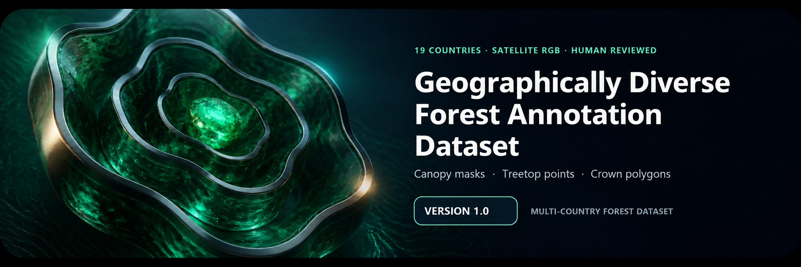
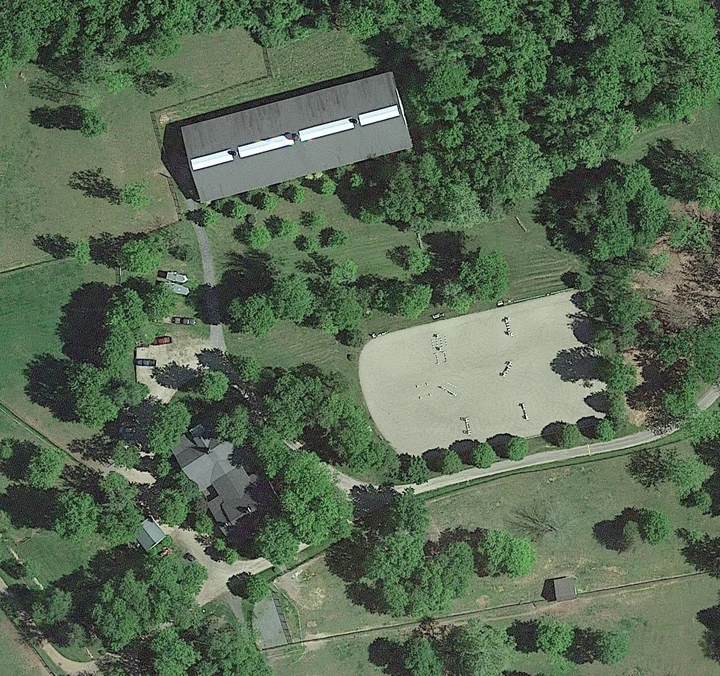
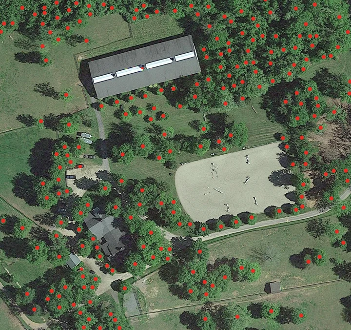
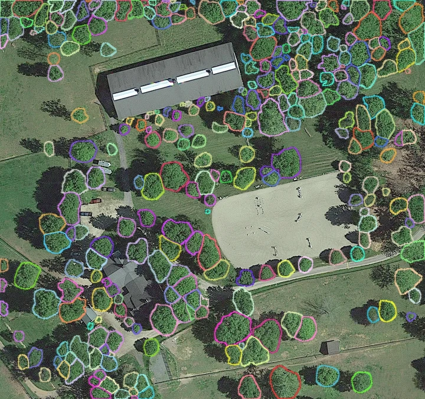
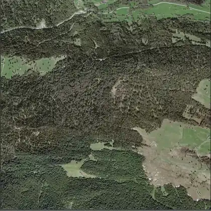
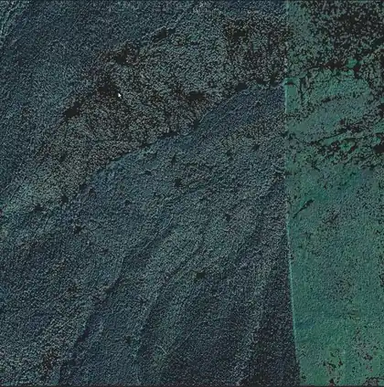
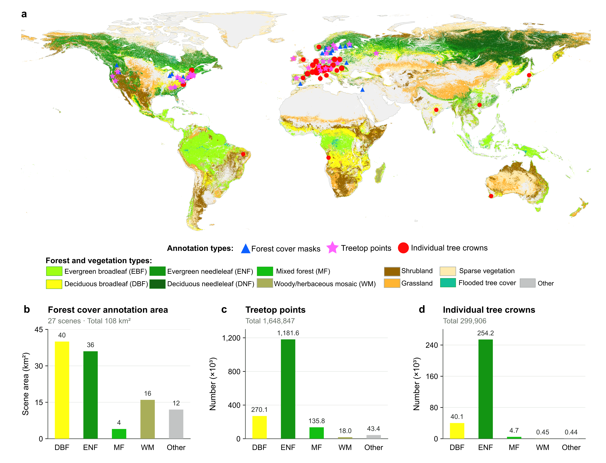
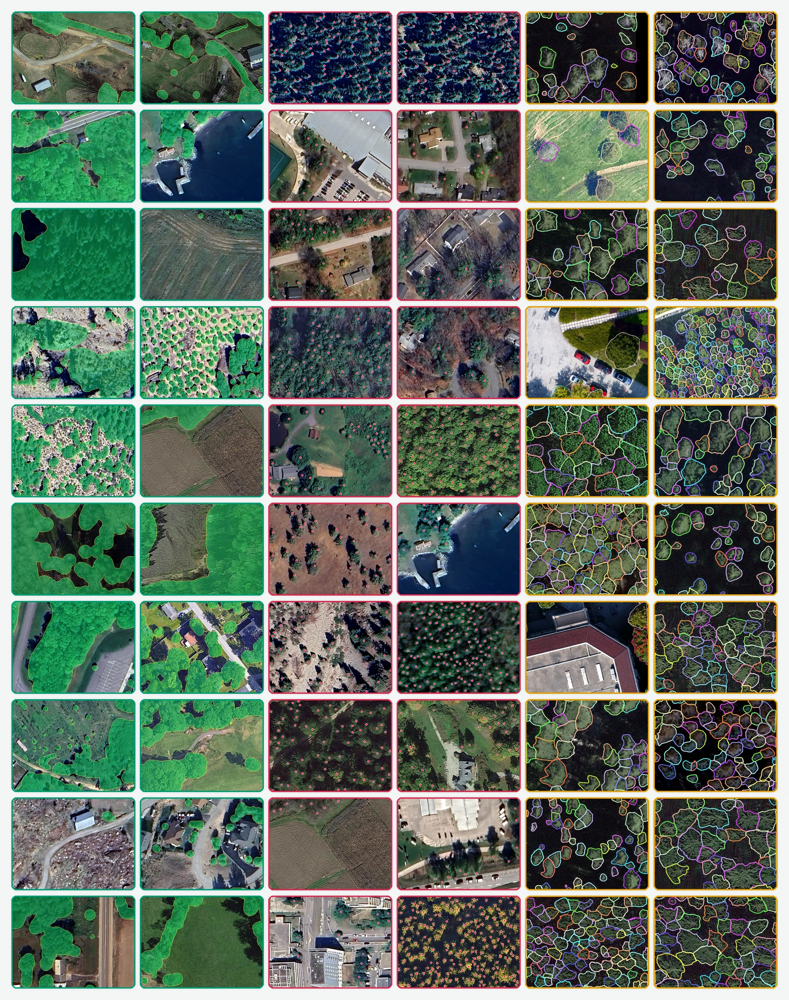
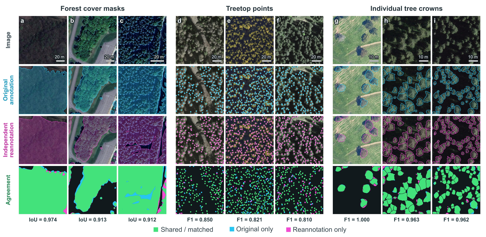

<div align="center">



[English](README.md) | **中文**

**基于 19 个国家卫星 RGB 影像的森林冠层掩膜、树顶点与单木树冠多边形标注数据集。**

[](#地理分布)
[](#标注生产流程)
[](examples/real_sample_package_v1/)
[](https://doi.org/10.5281/zenodo.22070748)

[概览](#概览) · [标注演示](#标注演示) · [场景图集](#场景图集) · [数据组成](#数据集组成) · [覆盖范围](#地理分布) · [标注流程](#标注生产流程) · [技术验证](#技术验证) · [数据获取](#数据获取) · [示例数据](#真实示例数据包) · [贡献者](#贡献者与机构)

</div>

## 概览

**完整数据下载：** [Zenodo 数据仓库](https://doi.org/10.5281/zenodo.22070748)。

**地理多样性森林标注数据集**收集了 19 个国家的卫星彩色（RGB）影像，提供三类标注：

- **森林冠层掩膜：** 勾勒出树冠覆盖的区域。
- **树顶点：** 用红点标记每棵树的树冠顶点。
- **单木树冠多边形：** 勾勒出每棵树的树冠轮廓。

### 用途与研究意义

- **统计冠层覆盖，分析森林结构。** 冠层掩膜可用于计算树冠覆盖面积和覆盖率，识别林中的空隙，分析树冠覆盖是连成一片还是分散成小块。用这些标注训练冠层分割模型后，可从影像中自动识别树冠覆盖区域，用于森林覆盖调查、城市树木覆盖统计和不同林分的比较。
- **定位和计数树木，分析树木分布。** 树顶点可用于训练和测试模型，识别影像中的树木位置，统计数量、密度和分布。研究人员还可以用这些点标注训练模型，探索只标记位置就能识别树木的方法，减少逐株勾画完整树冠的工作量。
- **区分相邻树冠，分析单株树冠的大小和形状。** 树冠多边形可用于训练单木树冠分割模型，提取每个树冠的轮廓、面积和形状，比较同一林分中树冠大小的差异。在树冠密集、相互接触或重叠的区域，可用人工轮廓检查模型是否漏掉树冠，或把多棵树的树冠识别成一个。

不同地区的森林在树冠形状、密度、背景和影像条件上差异很大。这些标注可用于研究：在一个地区训练的模型，应用到其他地区后能否继续准确识别树木。还可比较不同方法在稀疏树木、密集林分和复杂背景下的表现，找出容易漏检、误检的情况，改进识别方法，减少大范围调查中的人工标注工作。

| 标注类型 | 数据规模 | 场景或影像大小 | 文件格式 |
|:--|:--|:--|:--|
| **森林冠层掩膜** | **27 幅掩膜；108 km²** | 每个场景 2 km × 2 km | PNG/JPEG 格式的 RGB 掩膜影像 |
| **树顶点** | **30 个 SVG 文件、1,648,847 个点；120 km²** | 每个场景 2 km × 2 km | SVG 矢量标记 |
| **单木树冠多边形** | **5,061 幅 RGB 影像、299,906 条树冠标注** | 每幅影像 512 × 512 像素 | PNG/JPEG 影像与 COCO JSON 标注 |

### 影像与标注示例

<table>
  <tr>
    <td width="33.33%" align="center">
      <br><b>01 · RGB 影像</b><br><sub>原始场景</sub>
    </td>
    <td width="33.33%" align="center">
      <br><b>02 · 树顶点</b><br><sub>单株树冠顶点</sub>
    </td>
    <td width="33.33%" align="center">
      <br><b>03 · 树冠多边形</b><br><sub>单个树冠的边界</sub>
    </td>
  </tr>
</table>

从左到右依次为原始影像、用红点标记的树冠顶点，以及逐株勾画的树冠轮廓。

## 标注演示

<table>
  <tr>
    <td width="50%" align="center">
      <a href="assets/readme/treetop-annotation-demo.mp4"></a>
      <br><b>树顶点标注</b>
    </td>
    <td width="50%" align="center">
      <a href="assets/readme/crown-annotation-demo.mp4"></a>
      <br><b>单木树冠标注</b>
    </td>
  </tr>
</table>

树顶点在每幅 **2 km × 2 km** 的场景中逐株标记。演示展示了放大局部影像后，标记树冠顶点和勾画单株树冠轮廓的细节。

## 数据集组成

### 1. 森林冠层掩膜

森林冠层掩膜勾画树冠的覆盖范围，包括单棵树的树冠和连成片的冠层。树冠之间的空隙、道路、建筑、水体和裸地标为背景。

**27 幅掩膜均由人工通过 Adobe Photoshop 2022 勾画**，每幅覆盖 **2 km × 2 km**。完整数据以 RGB PNG/JPEG 格式保存，示例包另提供二值 PNG/TIFF 掩膜。

### 2. 树顶点

树冠顶点主要根据树冠形状和枝叶纹理判断。俯视针叶树时，枝叶纹理通常从四周向中心汇聚，汇聚的位置就是树冠顶点；斜视时，依据可见的树冠顶部判断。标注人员在 Inkscape 中用红点标记这些位置。阔叶树等没有明显顶点的树冠，则根据轮廓和纹理判断树冠中心，并在中心标记。

树顶点标注包含 **30 个 SVG 文件、1,648,847 个点**，每个文件对应 **2 km × 2 km** 的场景。

<details>
<summary>读取 SVG 标记时需要注意的细节</summary>

点的位置保存在 SVG 画布坐标中。叠加到影像时，需要根据画布范围和影像尺寸换算坐标，并检查是否对齐。红点可能以圆、椭圆或路径保存，颜色可能直接写在元素中，也可能由 CSS 样式设置。读取时应同时识别这些标记和颜色设置，避免漏读。

</details>

### 3. 单木树冠多边形

每个多边形勾画一棵树的树冠轮廓。相邻树冠接触或部分重叠时，根据树冠形状、枝叶纹理和边缘变化判断各自的范围，再分别勾画。

数据集包含 **5,061 幅 RGB 影像和 299,906 条树冠标注**，每幅影像为 512 × 512 像素。其中 3 幅没有树冠标注，作为训练集中的背景样本。树冠标注采用 COCO JSON 格式，只有一个类别 `tree_crown`（树冠）。

<details>
<summary>COCO 文件与坐标细节</summary>

影像包括 4,875 幅 PNG 和 186 幅 JPEG，5,058 幅含有树冠标注。每条标注记录影像与标注 ID、多边形坐标、`[x, y, width, height]` 形式的边界框、平方像素面积、`category_id = 1` 和 `iscrowd = 0`。坐标原点位于影像左上角，x 向右增加，y 向下增加。299,895 条记录包含一个多边形，11 条包含两个多边形。

</details>

树冠影像按 **原始场景** 划分训练集、验证集和测试集。同一幅原始影像裁出的小图都放在同一组，避免相邻区域同时出现在训练集和测试集中。

| 分区 | 影像数 | 树冠标注数 |
|:--|--:|--:|
| 训练集 | 4,144 | 255,983 |
| 验证集 | 247 | 8,244 |
| 测试集 | 670 | 35,679 |
| **合计** | **5,061** | **299,906** |

## 地理分布

<div align="center">



</div>

数据来自 **19 个国家**：安哥拉、澳大利亚、奥地利、巴西、加拿大、中国、丹麦、芬兰、德国、印度、意大利、日本、黎巴嫩、俄罗斯、西班牙、瑞典、瑞士、乌克兰和美国。影像涵盖针叶林、阔叶林、混交林和人工林，包括树木稀疏、冠层分散和冠层密集连片的场景，以及农田、城市和城郊的树木。

图中的三角形、星形和圆形分别表示冠层掩膜、树顶点和单木树冠的场景位置。地图下方的柱状图按森林和植被类型，分别统计冠层标注场景的面积、树顶点数量和单木树冠数量。

### 影像来源与像素大小

RGB 卫星影像主要通过 Google Earth Pro 获取，来源包括 WorldView、QuickBird 和 SPOT。选图时优先使用标注前五年内拍摄、无云且树冠清晰的影像；近期影像不符合要求时，再选择较早的清晰影像。

**导出影像的像素大小为 0.0651–0.1237 m**，按场景的地面范围和影像像素数计算。这表示导出影像中每个像素对应的地面长度；卫星原始影像的分辨率取决于影像来源。拍摄日期、影像来源、场景位置、影像尺寸和导出像素大小记录在 `scene_metadata.csv` 中。

## 场景图集

<div align="center">



</div>

左侧两列为冠层掩膜，中间两列为树顶点，右侧两列为单木树冠轮廓。绿色区域表示树冠覆盖，红点标记树冠顶点，不同颜色的轮廓区分各个树冠。图集展示了稀疏树木、密集林分、冠层空隙，以及道路和建筑附近的标注。

## 标注生产流程

9 名经过培训的标注人员完成了标注。冠层掩膜由人工在 Photoshop 中勾画，树冠顶点由人工在 Inkscape 中用红点标记。单木树冠数据中，约 **70% 的影像**由人工直接勾画；约 **30% 的影像**先用经过微调的 Cellpose-SAM 模型生成初步轮廓，再由人工检查和修改。

标注人员检查并修正每个模型候选树冠：把误连在一起的树冠拆开，将同一树冠的碎片合并，补上漏掉的树冠，删除误检，并调整轮廓。全部树冠标注经过人工检查后，再由 3 名复核人员分批复核，最后由另一名主审人员检查完整数据集。

程序检查文件能否正常读取、影像与标签是否对应、编号是否重复、坐标是否超出影像，以及树冠轮廓是否有效。发现问题后，修改并重新检查。

## 技术验证

一名独立标注者在不查看原标签的情况下，重新标注了 **214 个影像样本**：59 个冠层影像块、26 个树顶点影像块和 129 幅树冠影像。两套标注的比较结果如下。

| 标注类型 | 验证样本 | 匹配或比较方法 | 一致性结果 |
|:--|:--|:--|:--|
| 森林冠层掩膜 | 来自 21 个场景的 59 个影像块 | 二值掩膜逐像素重叠比较 | 平均 IoU **0.914**；平均 Dice **0.948** |
| 树顶点 | 来自 17 个场景的 26 个影像块 | 允许位置偏差 **15 像素**的一对一匹配 | 影像块平均 F1 **0.851**；计数 MAE **25.0 点/块** |
| 单木树冠 | 129 幅影像块 | **IoU ≥ 0.50** 的一对一匹配 | 影像平均检测 F1 **0.864**；匹配树冠 IoU 中位数 **0.807** |

<div align="center">



</div>

从左到右依次为冠层掩膜、树顶点和单木树冠多边形；从上到下依次为原始影像、原始标注、独立重标注和两套标注的一致性对比。

IoU 和 Dice 衡量两套掩膜有多少区域重叠。树顶点 F1 衡量两位标注者是否标出了相同的树，匹配时允许点的位置相差最多 15 个像素；计数 MAE 表示每个影像块的点数平均相差多少。树冠 IoU 衡量匹配树冠的轮廓重叠程度，检测 F1 则同时考虑匹配成功、漏标和多标的树冠。

### 模型测试结果

| 任务 | 模型 | 各模型的结果范围 |
|:--|:--|:--|
| 冠层分割 | U-Net、DeepLabv3+、SegFormer | 测试集 IoU **79.49–81.74%**；Dice **88.52–89.93%** |
| 树顶点定位 | U-Net、SegFormer、Mamba-UNet | 测试集点 F1 **72.65–76.33%**；计数 MAE **24.65–28.47 点/块** |
| 树冠实例分割 | Mask R-CNN、YOLOv8m-seg、Mask2Former、QueryInst、MaskDINO、StarDist-TCD | 掩膜 AP50:95 **26.51–52.44%**；AP50 **42.73–83.84%** |

每个模型训练一次后进行评估。在比较的树冠模型中，MaskDINO 的 AP50:95 和 AP50 最高。

## 数据获取

完整数据可通过 [Zenodo DOI 10.5281/zenodo.22070748](https://doi.org/10.5281/zenodo.22070748) 获取，包括冠层掩膜、树顶点 SVG 文件、树冠影像及 COCO 标注、场景信息和数据说明。树冠标注附带裁剪后的 RGB 影像，完整的原始场景影像不随数据集提供。

### 完整数据集目录

完整数据集的目录如下：

```text
dataset/
├── canopy_region/                 # 27 幅 PNG/JPEG 冠层掩膜
├── treetop/                       # 30 个 SVG 点标注文件
├── individual_crown/
│   └── images/                    # 5,061 幅 512 × 512 RGB 影像
├── annotations/
│   ├── instances_all.json
│   ├── instances_train.json
│   ├── instances_val.json
│   └── instances_test.json
└── scene_metadata.csv
```

## 真实示例数据包

[`examples/real_sample_package_v1`](examples/real_sample_package_v1/README.zh-CN.md) 提供 **12 个示例**，包含标注预览和下表所列的标签文件，可用于了解标注内容和读取格式。

| 数据组成 | 示例数 | 演示文件 |
|:--|--:|:--|
| 森林冠层掩膜 | 4 | 叠加预览、二值 PNG/TIFF 掩膜和覆盖率统计 |
| 树顶点 | 4 | 叠加预览及 CSV/JSON 坐标 |
| 单木树冠 | 4 | RGB 影像、轮廓预览、TIFF 实例掩膜和面积 CSV |

## 使用说明与局限

训练树冠分割模型时，可直接使用已划分的训练集、验证集和测试集。读取数据时，按影像编号找到对应标签，并检查标签与影像是否对齐。

阴影、树冠重叠和影像边缘会增加标注难度，可能造成漏标或轮廓不完整。密集林分中，多个树冠可能被看成一个；有多个明显顶峰的大树冠，也可能被分成几个。下层树木被上层冠层挡住时，影像中通常无法辨认。

比较模型结果时，树顶点定位需要注明允许的位置偏差。评估树冠分割时，既要检查树冠是否找全、找对，也要比较预测轮廓与人工轮廓的重叠程度。

## 许可与来源

标注数据、软件和影像分别适用以下条款：

- **标注数据与场景信息：** [CC BY 4.0](LICENSE-DATA.md)。
- **软件与脚本：** [MIT License](LICENSE-CODE)。
- **第三方影像及其预览图：** 使用时须遵守 Google Earth 和影像提供方的使用与署名要求，详见[第三方影像说明](THIRD_PARTY_NOTICES.md)。

## 贡献者与机构

<div align="center">

<table>
  <tr>
    <td align="center" width="33.33%">
      <a href="https://github.com/njyunting"><br><sub><b>Yun Ting</b></sub></a><br>
      <sub>通讯作者 · 南京林业大学</sub>
    </td>
    <td align="center" width="33.33%">
      <br><sub><b>Huaiqing Zhang · 张怀清</b></sub><br>
      <sub>通讯作者 · 中国林业科学研究院</sub>
    </td>
    <td align="center" width="33.33%">
      <br><sub><b>Lingfei Ma</b></sub><br>
      <sub>项目贡献者 · 华东师范大学</sub>
    </td>
  </tr>
  <tr>
    <td align="center" width="33.33%">
      <br><sub><b>Wenjie Yang · 杨文杰</b></sub><br>
      <sub>共同第一作者 · 南京林业大学</sub>
    </td>
    <td align="center" width="33.33%">
      <br><sub><b>Enhao Xu · 许恩浩</b></sub><br>
      <sub>共同第一作者 · 南京林业大学</sub>
    </td>
    <td align="center" width="33.33%">
      <br><sub><b>Li Zhang</b></sub><br>
      <sub>论文作者 · 南京林业大学</sub>
    </td>
  </tr>
  <tr>
    <td align="center" colspan="3">
      <br><sub><b>Chenhui Bai · 白晨辉</b></sub><br>
      <sub>项目贡献者</sub>
    </td>
  </tr>
</table>

</div>
